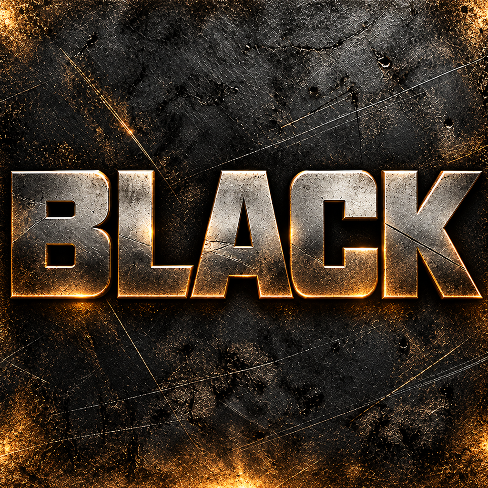

<h1 align="center">BLACK</h1>

An unofficial native Apple Silicon port of <i>BLACK</i> for Original Xbox. Bring your own supported USA or European disc image.

<a href="#download"><b>Download</b></a> · <a href="#quick-start">Quick start</a> · <a href="#highlights">Highlights</a> · <a href="#controls-and-settings">Controls</a> · <a href="docs/BUILD.md">Build</a> · <a href="CHANGELOG.md">Changelog</a> · <a href="#acknowledgements">Acknowledgements</a>

> [!IMPORTANT]
> This is a non-commercial fan project, not affiliated with or endorsed by Electronic Arts,
> Criterion Games, Microsoft or Apple. No disc images, original executables, game assets,
> music, saves or generated game sources are distributed. You need your own supported
> Original Xbox BLACK disc. Please do not request game files or attach them to issues.

> [!NOTE]
> **0.1.0 is the first experimental macOS release.** Combat, menus and profile saving
> have been exercised on the development Mac. A complete playthrough, all runtime races,
> audio quality and controller calibration are not yet qualified. [Validation](docs/VALIDATION.md).

## Download

**[BLACK 0.1.0 — macOS / Apple Silicon](https://github.com/secretpray/Black/releases/tag/v0.1.0)**

| Download | Purpose |
| --- | --- |
| `BLACK-0.1.0-macos-arm64.dmg` | App for Apple Silicon and **macOS 27 or later** |
| `SHA256SUMS` | Optional download integrity check |
| `optional-library-sources.tar.xz` | Runtime/library sources and build recipes; not needed to play |

Bundled libraries currently require macOS 27+. Older macOS versions, Intel Macs,
Linux and Steam Deck are not qualified. GitHub's automatic **Source code** downloads
are source snapshots, not playable apps.

## Quick start

1. Open the DMG and drag **BLACK.app** to **Applications**.
2. Open **BLACK** from Applications or your app launcher.
3. Choose your own **Original Xbox BLACK ISO/XISO** or extracted disc folder.
   The app validates the revision and copies files into your Library. Your source
   stays unchanged. The supported European executable is normalized in that private copy.
4. **F1/F10**, **Cmd+,** or **Back + Start** opens recomp settings.

The app is **ad-hoc signed, not notarized**. If macOS blocks it, use
**System Settings → Privacy & Security → Open Anyway** after checking the download source.
No Homebrew, Python or development checkout is required to run the DMG app.

Supported USA executable SHA-256:
`df2739c372d254a90aeeccf5971d12097f22d89fbb90db021fda96dd4deb68f6`.
Supported European executable SHA-1:
`796ad8369354e48aa15644d4707dd70bd3bc3b4c`.
PS2 and Xbox 360 files are not supported.

## Highlights

- Native ARM64 game code, NV2A rendering through ANGLE Metal and the DSP audio path.
- Saved 1–6× render scale, camera FOV, SMAA/FXAA, anisotropic filtering and MetalFX
  spatial upscaling. Graphics changes take effect on the next launch.
- A TGP-inspired panel with **Recomp Settings**, **Mouse and Keyboard** and
  **Controller** pages, using fonts from your own game.
- Separate stick/trigger deadzones, explicit drift measurement, live axes,
  normal/aim X/Y sensitivity, hold-to-aim, aim assist and rumble intensity.
- Direct mouse look, two bindings per action, Flash menu cursor navigation
  and keyboard profile-name entry.
- Console-style gameplay timing around 30 updates per second. Unlocked-FPS
  physics and guaranteed 60 FPS are not advertised.
- Native fullscreen and Game Mode opt-in. Activation was observed on the test Mac;
  macOS controls it. FPS and controller latency improvements were not measured.
- Separate installation, settings, saves and per-session logs.
- A **Mods** page: film skipping, God Mode, infinite medkits, grenades and
  ammo, Always Silenced, mission and Black Ops unlocks, M16A2 and the BFG code,
  all off by default (in development, not in the 0.1.0 download).
  [Validation and limits](docs/VALIDATION.md#mods-page-and-fps-counter-in-development).

## Controls and settings

| Action | Default |
| --- | --- |
| Recomp settings | F1 / F10 / Cmd+, / Back + Start |
| Change settings page | Q / E, Tab, LB / RB |
| Fullscreen / quit | Cmd+Return / Cmd+Q |
| Move / crouch / walk | W A S D / C / Alt |
| Fire / aim / reload / interact | Left mouse / right mouse / R / F |
| Melee / grenade / silencer / medkit | V / G / T / H |
| Change weapon | Q / E or mouse wheel |
| Objectives / pause | Tab / Escape |
| Game menus | Click / wheel / arrows; Enter confirms, Escape or right mouse goes back |

Click the game to capture the mouse in play. Escape releases it and pauses;
game menus release it automatically. Mouse motion alone does not take control
away from a gamepad. Measure drift with the sticks released, then test the
smallest comfortable deadzone on your own controller. Physical calibration,
rumble and hotplug still need broader acceptance testing.

## Your data and updates

Data is stored in `~/Library/Application Support/BLACK/`:

| Folder/file | Purpose |
| --- | --- |
| `Game/` | Your privately installed game files |
| `Data/xboxrecomp/` | Xbox saves, metadata and virtual cache partitions |
| `settings.ini` | Recomp preferences and bindings |
| `Logs/run-*/` | A separate log for every launch |

Replacing the app in Applications leaves Library data intact. Back up `Data/`
before changing save files. Development launcher data under `out/macos/user/`
is separate and is not automatically migrated or deleted.

## Building and reporting issues

[Build instructions](docs/BUILD.md) cover pinned sources, revision checks and packaging.
The root tree/history retains the upstream Windows implementation; its D3D12
features do not describe this Mac build. [Upstream README](docs/UPSTREAM_README.md).

Include the version, Mac model, macOS version, settings and reproduction steps
when reporting a problem. Distinguish a normal exit from a time limit.
Do not attach game data, private saves or unredacted personal information.

## Acknowledgements

Special thanks to **[TGP482 / BLACK-XBERecomp](https://github.com/TGP482/BLACK-XBERecomp)**
for the Original Xbox BLACK recompilation project, Xbox XBE Recomp tooling,
settings/menu design, control policies and the checked European revision patch.

Thanks to **elpetese** for the [native macOS game host](https://github.com/elpetese/black-macos-recomp)
and [runtime](https://github.com/elpetese/black-macos-runtime), **sp00nz** and
**portingpete** for xboxrecomp and BLACK runtime work, the **xemu** team for Xbox
hardware/rendering/audio foundations, **Matt Borgerson** for dsp56300, and the
**ANGLE**, **SDL** and other library contributors.

The [Burnout Revenge project](https://github.com/secretpray/burnout-revenge) served
as a product and packaging reference. BLACK keeps its own code, runtime ABI and data.
See [component provenance](THIRD_PARTY_NOTICES.md) and the app's
`Contents/Resources/Licenses/` for upstream licenses. The combined executable
contains differently licensed components and is not described as wholly MIT licensed.
