

<h1 align="center">BLACK</h1>

An unofficial native Apple Silicon port of <i>BLACK</i> for Original Xbox. Bring your own supported USA or European disc image.

<a href="#download"><b>Download</b></a> · <a href="#quick-start">Quick start</a> · <a href="#highlights">Highlights</a> · <a href="#mods">Mods</a> · <a href="#controls-and-settings">Controls</a> · <a href="docs/BUILD.md">Build</a> · <a href="CHANGELOG.md">Changelog</a> · <a href="#acknowledgements">Acknowledgements</a>

> [!IMPORTANT]
> This is a non-commercial fan project, not affiliated with or endorsed by Electronic Arts,
> Criterion Games, Microsoft or Apple. No disc images, original executables, game assets,
> music, saves or generated game sources are distributed. You need your own supported
> Original Xbox BLACK disc. Please do not request game files or attach them to issues.

> [!NOTE]
> **0.10.0 is an experimental macOS release.** A Mods row, **Reticle Shape**,
> draws the aiming mark as a ring, a ring with ticks, a cross or chevrons from
> the game's own HUD texture, or picks one by weapon (**Auto**). From 0.9.0:
> **HD Reticle** rebuilds the
> game's own HUD texture at four times its size for a sharper aiming dot, the
> **Performance Overlay** can show frame times, **Save Black Box** keeps the last
> minute of controller input for a report, and a Mods row puts a sniper rifle in
> the first mission. From 0.8.0: each save slot shows its last
> mission, the time spent in missions and a picture of the game, and each mission
> its best time, fewest deaths and best accuracy. From 0.7.1: the settings'
> prompts stand in a column as on the game's own pages. From 0.7.0: the game's own checkpoint is kept
> between launches: **Continue Mission** on the title resumes it, and F9 or
> Back + Y go back to it in a mission after a question. Checkpoints follow the
> game's Autosave, with a Checkpoints row under it in Options → Profile.
> **Display Brightness** and **Display Gamma** adjust the picture over the game's
> own brightness. From 0.6.1: saved profiles load again after the
> first profile list instead of showing every slot as damaged. The settings are a
> nested menu in the game's style with a **Saves** section: import, export,
> delete and back up profile slots. On the name keyboard X deletes, Y types a
> space and Start finishes; the game window remembers its size, place and full
> screen, with Cmd+H, Cmd+M and a Window menu. From 0.6.0: the game's own
> brightness curve, brightness slider and fades reach the screen. Home / Xbox Guide / PS opens the
> settings with a tap and a quit page with a hold, without opening Game Center;
> A, Start or Enter skips any film; the Dock icon brings the game back. From 0.5.5:
> later areas of a mission no longer drop to 15-18 fps, and bloom and sun shafts
> render as on the Xbox. From 0.5.4:
> the title screen shows PRESS START, the copyright line and the logo again.
> From 0.5.3: HD textures no longer paint the grenade crate black or pickup
> weapons white. From 0.5.2: controllers can be
> unplugged and reconnected over USB or Bluetooth during play, a Bluetooth
> DualSense answers sooner after the desktop, and turning on HD textures checks
> for the pack and offers to choose its folder. Vibration, Controls, button prompts, setup,
> Russian text and subtitles from earlier releases remain included. Hotplug was
> physically checked on the development Mac with DualSense controllers; a
> complete playthrough, all runtime races, audio quality and other controller
> models remain unqualified. [Validation](docs/VALIDATION.md).

  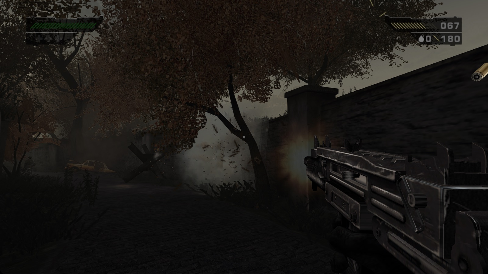

<table>
  <tr>
    <td width="50%">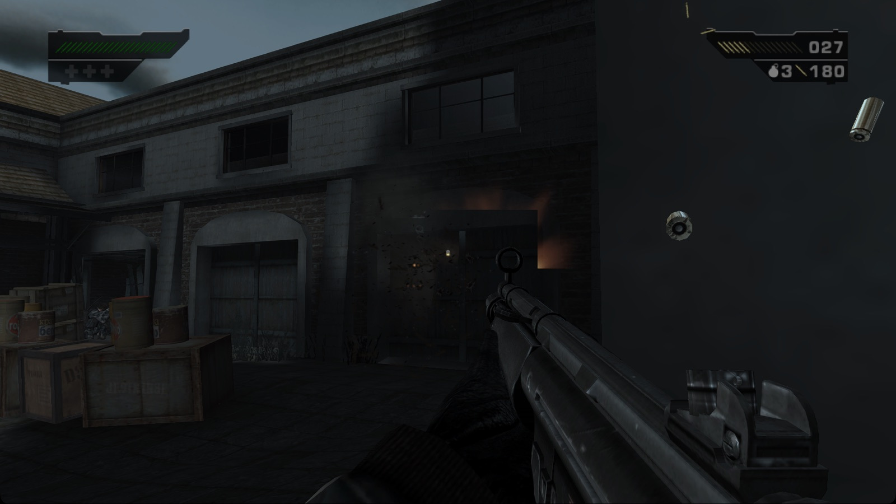 A burning courtyard.</td>
    <td width="50%">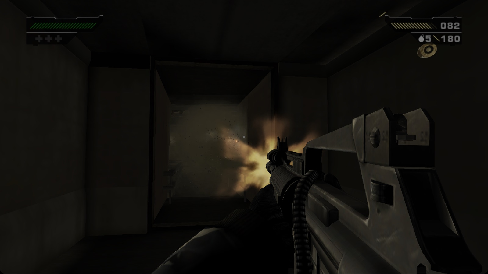 Muzzle flash in a dark corridor.</td>
  </tr>
  <tr>
    <td width="50%">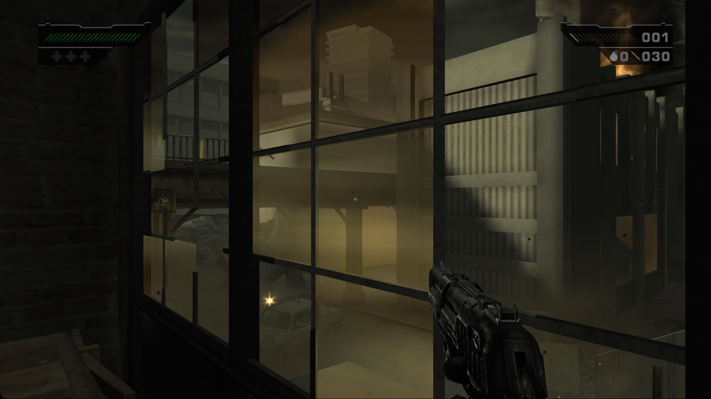 The first mission, by the windows.</td>
    <td width="50%">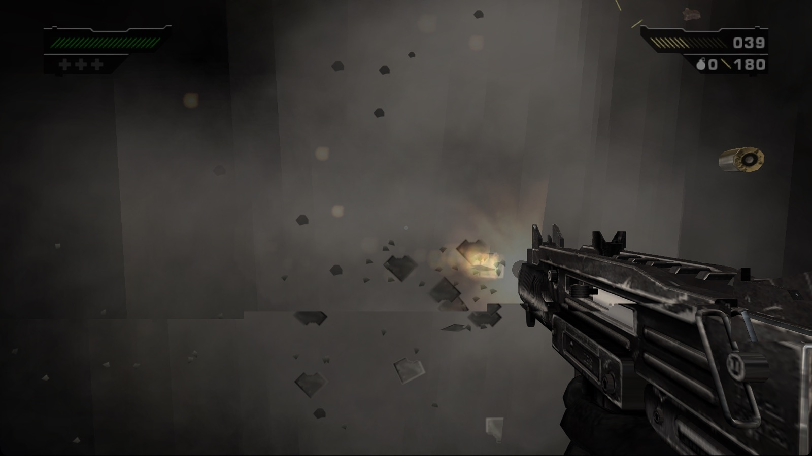 Walls break apart under fire.</td>
  </tr>
</table>

Unedited macOS screenshots from this port on an M1 Pro, 2× render scale with SMAA and
MetalFX. The game content in them belongs to its owners.

## Download

**[BLACK 0.10.0 — macOS / Apple Silicon](https://github.com/secretpray/Black/releases/tag/v0.10.0)**

| Download | Purpose |
| --- | --- |
| `BLACK-0.10.0-macos-arm64.dmg` | App for Apple Silicon and **macOS 27 or later** |
| `SHA256SUMS` | Optional download integrity check |
| `optional-library-sources.tar.xz` | Runtime/library sources and build recipes; not needed to play |

Bundled libraries currently require macOS 27+. Older macOS versions, Intel Macs,
Linux and Steam Deck are not qualified. GitHub's automatic **Source code** downloads
are source snapshots, not playable apps.

## Quick start

  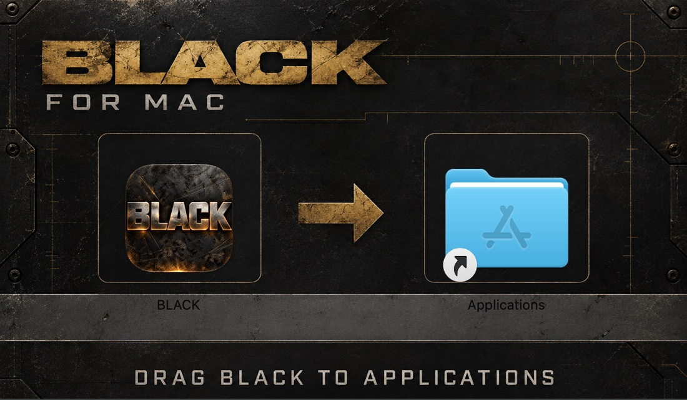

1. Open the DMG and drag **BLACK.app** to **Applications**.
2. Open **BLACK** from Applications or your app launcher.
3. First-time setup, drawn like the game's own menus, asks for your own
   **Original Xbox BLACK ISO/XISO** or extracted disc folder: choose it or drop it
   onto the window. It shows the release, languages and size before copying,
   then copies into your Library with progress; **Stop** keeps what was copied and
   the next install carries on from there. Your source stays unchanged. The
   supported European executable is normalized in that private copy. Then pick
   the game text from your disc's languages and the graphics settings; they
   apply on the first start. Use the mouse or keyboard; controller navigation
   is built in but not yet tested with a physical pad.
4. **F1/F10**, **Cmd+,** or **Back + Start** opens recomp settings.

The app is **ad-hoc signed, not notarized**. If macOS blocks it, use
**System Settings → Privacy & Security → Open Anyway** after checking the download source.
No Homebrew, Python or development checkout is required to run the DMG app.

Supported USA executable SHA-256:
`df2739c372d254a90aeeccf5971d12097f22d89fbb90db021fda96dd4deb68f6`.
Supported European executable SHA-1:
`796ad8369354e48aa15644d4707dd70bd3bc3b4c`.
PS2 and Xbox 360 files are not supported.

## Highlights

- Native ARM64 game code, NV2A rendering through ANGLE Metal and the DSP audio path.
- Saved 1–6× render scale, camera FOV, SMAA/FXAA, anisotropic filtering and MetalFX
  spatial upscaling. Graphics changes take effect on the next launch.
- The game's own brightness and gamma ramp, with its fades to and from black,
  as the Xbox's video output applies it; **Display Brightness** and **Display
  Gamma** adjust the picture over it, and leave it exactly as it is at 0 / 1.00.
- **Checkpoints between launches**: Continue Mission on the title resumes the
  last one, F9 or Back + Y go back to it in a mission.
- At render scales above 1×, the game's small glow and blur buffers are averaged
  over one Xbox texel before its blur samples them, as on the console's
  resolution.
- **Home / Xbox Guide / PS**: tap for the settings, hold for a quit page in the
  game's own menu style; macOS keeps Game Center out of the way while BLACK has
  focus. The Dock icon and Dock **Quit** work as for any Mac app.
- A panel in the game’s own green-grey menu style, using fonts from your own game.
  It is a nested menu: **General**, **Controls**, **Mods** and **Saves** open
  their pages, Back climbs one level, and the selected item is described under
  the list. Y / Triangle or Backspace resets a setting.
- An optional **Performance Overlay**: the game's own frame rate and the
  display's, or frame times as well (median, 95th percentile and worst frame).
- **HD Reticle**: the game's own HUD texture rebuilt at four times its size, for
  a sharper aiming dot and crisper small HUD marks. The game still colours the
  dot; no picture is shipped. Off by default, live.
- Optional **HD texture replacement** from your own copy of the PCSX2 "BLACK HD
  Reimagined" pack, through portingpete's map: turn on **General →
  Textures** and choose the pack's folder when asked. BLACK checks it and links
  it into `~/Library/Application Support/BLACK/Textures/replacement/` without
  copying (files placed there yourself work too). **HD Texture Size** limits the
  largest side to 1024, 2048 (default) or 4096 pixels. The pack is not included.
- Game text in English, French, German, Spanish or Italian from your disc, or
  Russian: the app carries the translation text only and builds the Russian
  bank and Cyrillic letters into your own installed copy when the game starts,
  and shows Russian subtitles in the mission briefing films.
  The settings panel has English, French, German, Spanish, Italian and Russian.
- Separate stick/trigger deadzones, explicit drift measurement, live axes,
  normal/aim X/Y sensitivity, hold-to-aim, aim assist and rumble intensity.
- Direct mouse look, two bindings per action, Flash menu cursor navigation
  and keyboard profile-name entry.
- Console-style gameplay timing around 30 updates per second. Unlocked-FPS
  physics and guaranteed 60 FPS are not advertised.
- Native fullscreen and Game Mode opt-in. Activation was observed on the test Mac;
  macOS controls it. FPS and controller latency improvements were not measured.
- Separate installation, settings, saves and per-session logs.

<table>
  <tr>
    <td width="50%">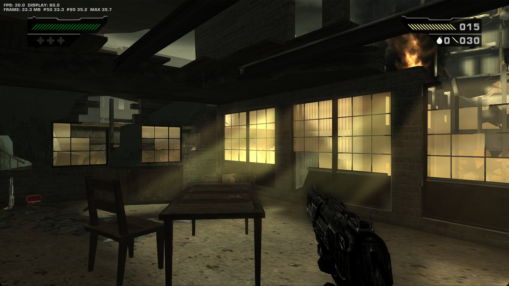 Performance Overlay with frame times, in the first mission.</td>
    <td width="50%">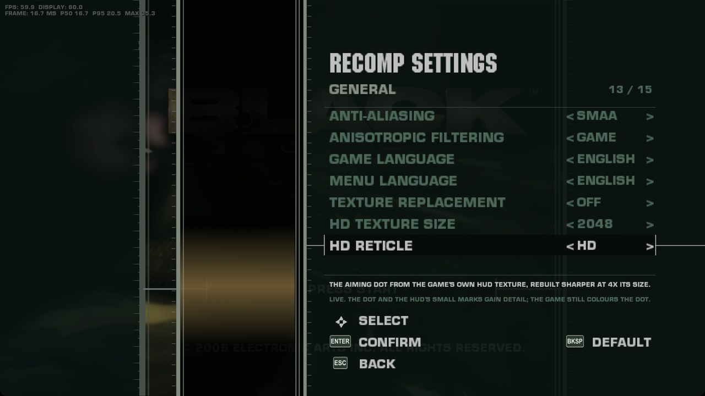 HD Reticle on the General page.</td>
  </tr>
</table>

## Mods

  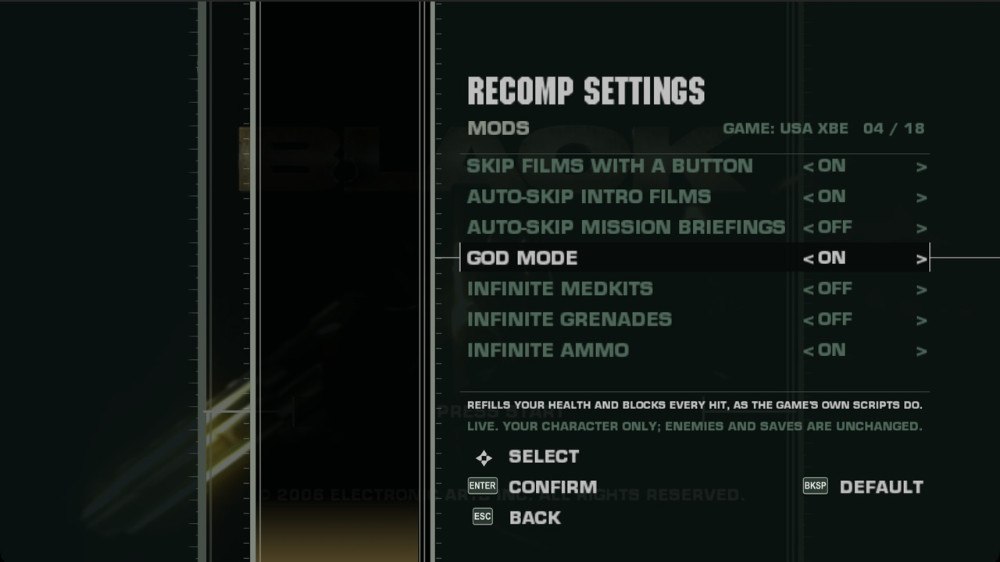

The **Mods** page collects cheats and modifications, all **off by default**
except **Skip Films with a Button**:

| Group | Mod | What it does |
| --- | --- | --- |
| Films | Skip Films with a Button (on by default) | A, Start or Enter skips any film, also the logos and the films the game lets you skip only after that mission; a hint shows the button after 2.5 seconds; looping menu backgrounds stay |
| Films | Auto-Skip Intro Films / Auto-Skip Mission Briefings | Skips the startup films and mission briefings without a press |
| Player | God Mode | Refills your health and holds the game's own invulnerability flag, so no hit gets through |
| Player | Infinite Medkits / Infinite Grenades | Keeps three medkits (the game's limit) and nine grenades |
| Player | Infinite Ammo | Your magazine and reserve never go down, with any weapon you hold |
| Player | Silver Weapons | The game's own Silver Weapons reward: magazines refill, 999 shown |
| Player | Rapid Fire | Your weapon fires 2, 3 or 4 times as fast (at most one shot a frame) |
| Player | No Recoil | Your shots no longer kick the view up |
| Player | One-Hit Kill | Any hit of your bullets kills a soldier |
| Player | Game Speed | 50%, 75%, 150% or 200% of the game's pace in play; menus and films keep theirs |
| Player | Always Silenced | Fits a silencer everywhere the old +9 trainer did (experimental) |
| Player | Reticle Shape | The aiming mark: the game's dot, a ring, a ring with ticks, four chevrons, a small thin cross, a single upward chevron or an open four-bar crosshair modelled on Call of Duty: Modern Warfare's hip-fire crosshair, or Auto: a ring for shotguns and launchers, a cross for the other weapons, the dot for the sniper rifle. The ring, ticks and chevrons are the game's own HUD cells; the thin cross, the upward chevron and the crosshair are painted into three empty blocks of that atlas when its texture is built, so they work with HD Reticle on or off; the game still colours the mark |
| Unlocks | Unlock All Missions / Unlock Black Ops Difficulty | Opens every mission and the Black Ops difficulty |
| Unlocks | M16A2 at Mission Start | The Black Ops reward rifle as your starting weapon |
| Unlocks | M249 in the First Mission | The developers' code, the same as a `XXXX-XXXX-XXXX-XXXX` profile name: an M249 with 600 rounds instead of the first mission's rifle; the gun has no texture there |
| Unlocks | Sniper in the First Mission | The sniper rifle in your second slot when the first mission starts, with five magazines; the mission's own first weapon stays, and a checkpoint keeps the weapons it saved |

Rapid Fire, One-Hit Kill, No Recoil, Game Speed and the stronger God Mode
come from [TGP482/BLACK-XBERecomp#141](https://github.com/TGP482/BLACK-XBERecomp/pull/141)
(ported there from Black-Android). Silver Weapons and the M16A2 apply from the
next mission start or restart. Unlocks are
saved into your profile, and turning a mod off never relocks earned progress.
Addresses are kept per game revision; the page shows the detected one, and an
unrecognised executable leaves every mod off.

<table>
  <tr>
    <td width="50%">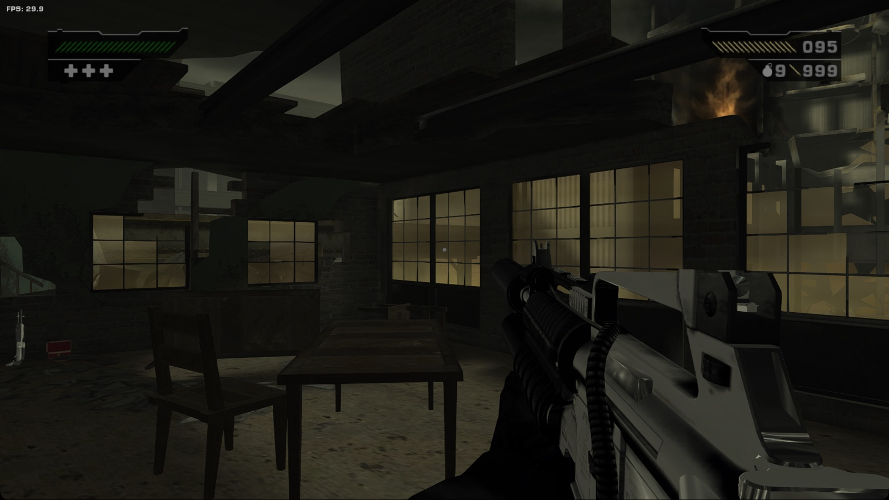 Mods in play, with the FPS counter.</td>
    <td width="50%">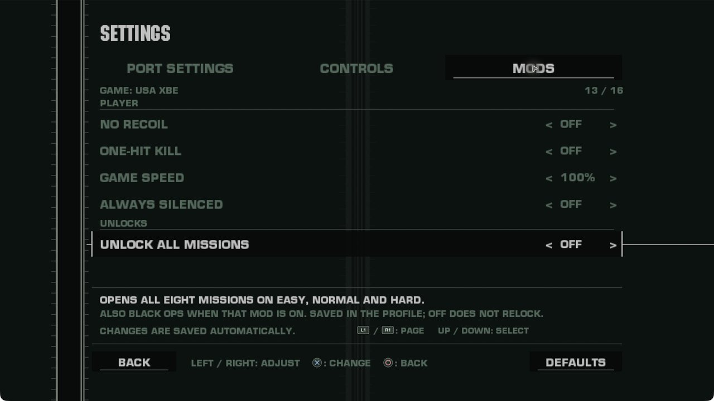 Player mods and unlocks.</td>
  </tr>
</table>

## Controls and settings

| Action | Default |
| --- | --- |
| Recomp settings | F1 / F10 / Cmd+, / Back + Start / tap Home, Xbox Guide or PS |
| Quit page: continue, main menu, quit | Hold Home, Xbox Guide or PS for 1.5 s / settings → Quit Game |
| Restart from the checkpoint (asks first) | F9 / Back + Y in a mission |
| Change settings page | Q / E, Tab, LB / RB |
| Fullscreen / quit | Cmd+Return / Cmd+Q |
| Move / crouch / walk | W A S D / C / Alt |
| Fire / aim / reload / interact | Left mouse / right mouse / R / F |
| Melee / grenade / silencer / medkit | V / G / T / H |
| Change weapon | Q / E or mouse wheel |
| Objectives / pause | Tab / Escape |
| Game menus | Click / wheel / arrows; Enter confirms, Escape or right mouse goes back |

<table>
  <tr>
    <td width="50%">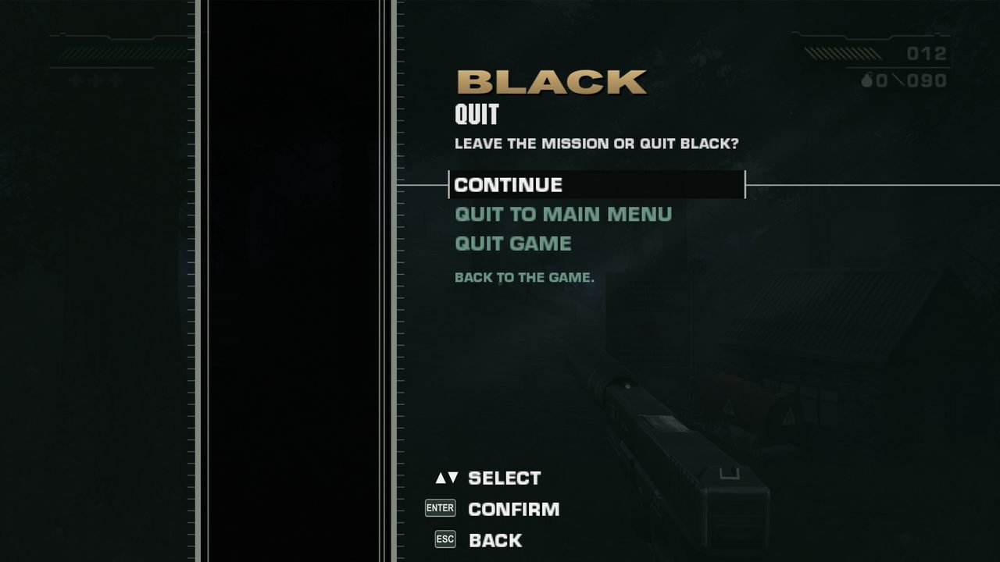 Hold Home: continue, the game's main menu, or quit.</td>
    <td width="50%">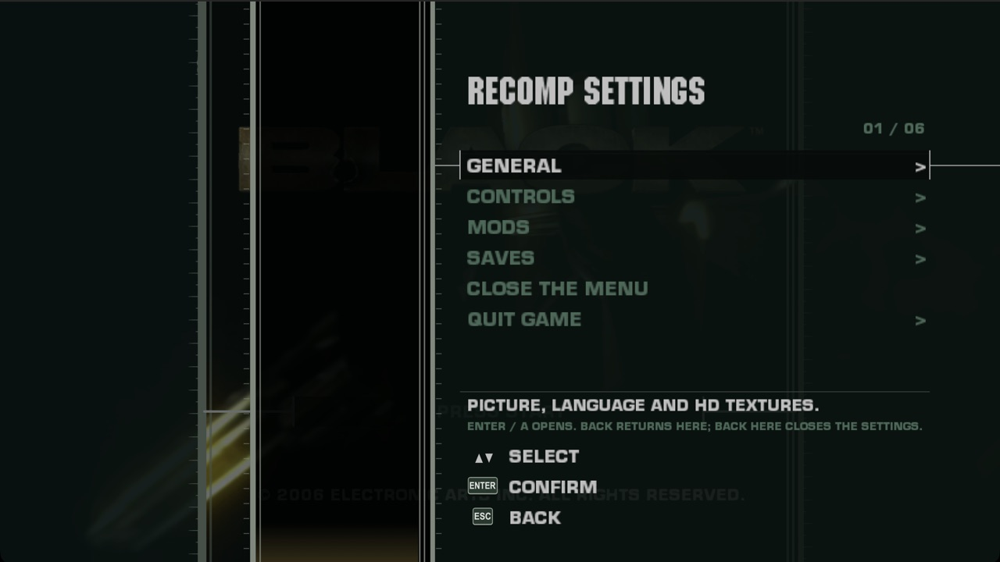 The settings: General, Controls, Mods, Saves, Quit Game.</td>
  </tr>
</table>

While BLACK has focus, macOS gives Home / Xbox Guide / PS to the game instead of
Game Center; it is handed back when you switch away. Quit to Main Menu opens the
game's pause menu and its own confirmation, so checkpoint progress is only lost
after you answer YES there.

<table>
  <tr>
    <td width="50%">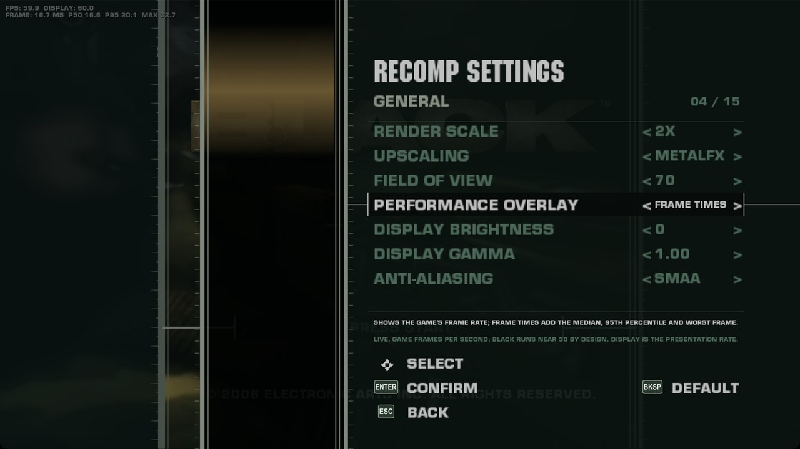 Recomp Settings: scale, upscaling, FOV, Performance Overlay.</td>
    <td width="50%">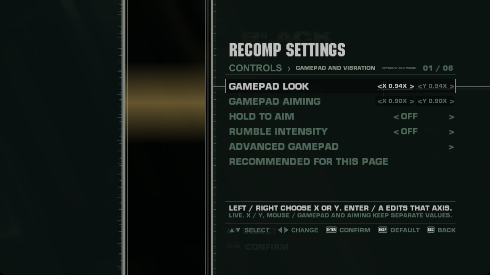 Gamepad response on its own page.</td>
  </tr>
</table>

Open **Controls**. Device and prompt
selection are the first two rows, followed by **Button Bindings**, **Mouse and
Aiming**, and **Gamepad and Vibration**. [Input details and checks](docs/INPUT.md).

| Setting | Behaviour |
| --- | --- |
| Input Device | **Auto**, **Gamepad** or **Keyboard**. Auto starts with a connected pad; a deliberate key or mouse button can take over after the pad settles. Mouse motion alone leaves the pad in control. |
| Button Prompts | **Auto**, **Xbox**, **PlayStation** or **Keyboard**, independent of input selection. Auto follows the active device and SDL's controller family. |
| Controller Bindings | Reassign the 16 Xbox button/trigger controls. Select a row, press Enter, release all pad buttons, then press one. Escape cancels; Delete clears. Left/right also select a button. |

**Button Bindings → Edit Bindings For** selects Keyboard and Mouse or Gamepad
without changing gameplay input. Keyboard and mouse actions keep two bindings each.
Mouse and pad sensitivity live on their own pages as independent Look/Aiming
X/Y pairs. Deadzones, driver selection and live calibration are under
**Gamepad and Vibration → Advanced Gamepad**.
Game hints use the current binding. PlayStation buttons, shoulder/trigger
buttons, sticks, keyboard caps and mouse buttons use drawn pictures, shared
with the settings panel. The app prepares them in a private per-run view,
leaving source fonts intact. Missing font support falls back to button names.
Switching from pad to keyboard restores mouse look during gameplay. Game menus keep their physical confirm/back
buttons; gameplay rebinding is for BLACK's default control scheme. Settings
remain accessible by keyboard even with Gamepad selected and no pad connected.
Reset buttons affect the current page or binding list, preserving device choice,
prompt style and other pages. Back returns to the previous page and focus;
capture or axis editing is cancelled first.

<table>
  <tr>
    <td width="50%">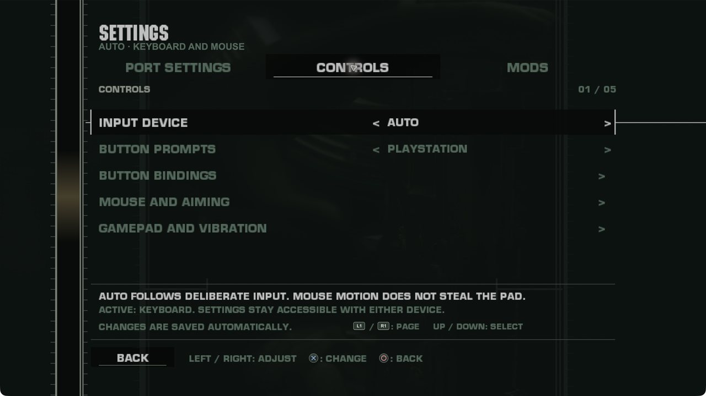 Choose gameplay input and button prompts independently.</td>
    <td width="50%">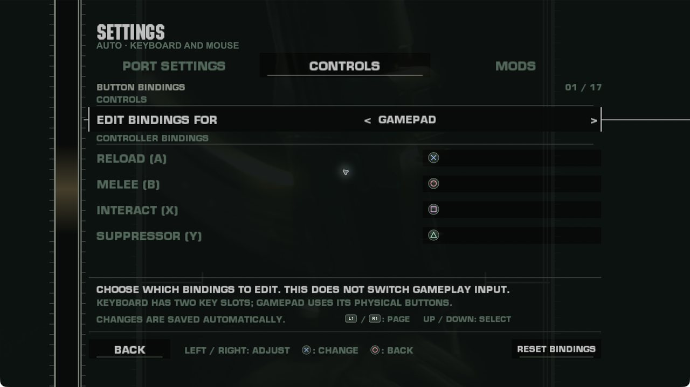 Rebind the pad; prompts follow the selected family.</td>
  </tr>
</table>

Settings captured from the running game window, with its title bar removed,
resized and compressed. The diagnostic run used scripted input, with no physical
controller connected; these images do not qualify hardware behaviour.

Click the game to capture the mouse in play. Escape releases it and pauses;
game menus release it automatically. Mouse motion alone does not take control
away from a gamepad. Measure drift with the sticks released, then test the
smallest comfortable deadzone on your own controller. Bluetooth DualSense
vibration/on-off, one Reload button rebind, keyboard/mouse handoff, mouse fire,
input after desktop return and USB/Bluetooth disconnect/reconnect (including
two DualSense controllers) have been checked on the development Mac. Other
controllers, trigger rebinds and broader calibration still need acceptance
testing.
A manual Gamepad choice selects the controller input path; selecting a particular
pad among several connected devices is not implemented.

## Saves

The Xbox build keeps its three operator profiles as slots of one signed file and
has no way to delete or copy them; the Xbox dashboard did that. **Saves** in the
settings lists the slots with their progress. A slot's page shows its missions,
replaces or fills it from a **zip**, a save folder or a profile file (put them in
`Data/Import/`, or pick one), exports it to `Data/Export/`, and deletes it as a
console writes an empty slot. A slot the game has marked as damaged can be
cleared. Changes apply on the game's main menu pages; the slot the game
autosaves to is greyed out, and every change asks Yes or No first.

Each change keeps the file as it was in `Data/xboxrecomp/ProfileBackups/`, named
with its time and reason, and one is made at launch when the profile changed
since. The newest 30 are kept; any backup can be restored, and one or all can
be moved to the Trash. Only saves on this Mac are used: BLACK does not talk to a
console.

  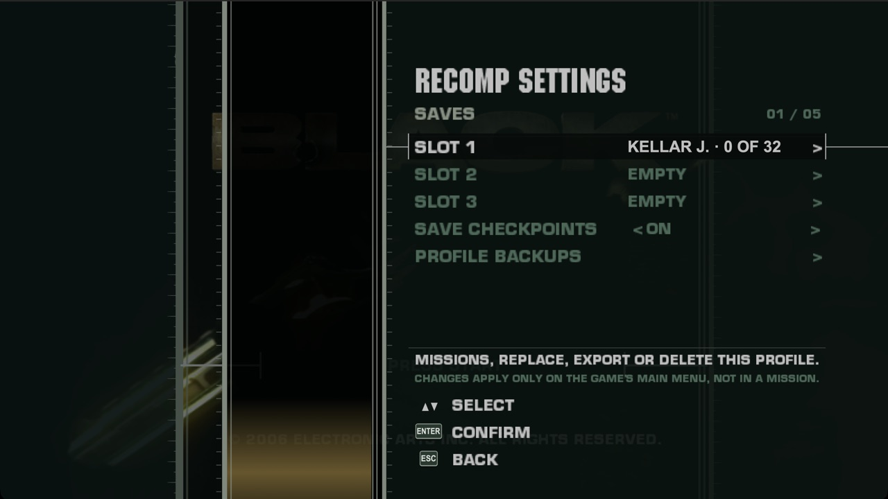

After each profile save BLACK also keeps a record of the slot beside the saves,
in `Data/xboxrecomp/SlotInfo/`: the mission last played, the time spent in
missions, the date and a picture of the game from that run. Each completed
mission run adds its time, deaths (Mission Failed's Continue or Restart), the
checkpoints reached and its accuracy: the shots that hit a soldier, so fire at
cover and vehicles counts as missed. The profile itself is not changed; when it
no longer matches the record (an import, a restore), the page shows the profile
alone. Time and results count from the first save made with 0.8.0.

<table>
  <tr>
    <td width="50%">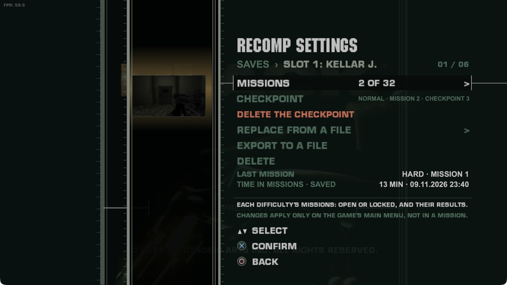 A slot's last mission, time and picture.</td>
    <td width="50%">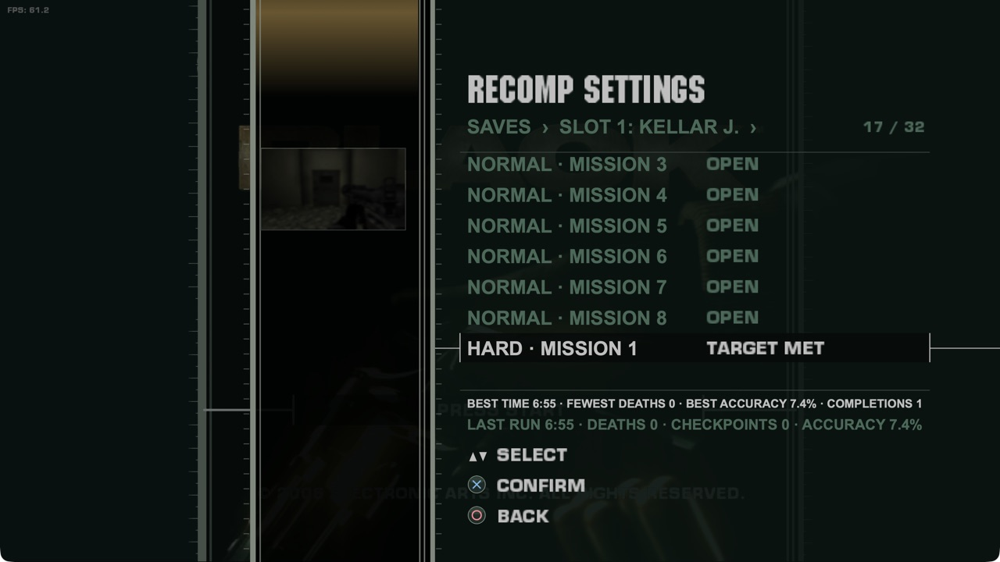 A mission's best results and last run.</td>
  </tr>
</table>

## Checkpoints

The console keeps a mission's checkpoint only while the game runs, so a long
mission had to be played again from its start after quitting. BLACK writes the
game's own checkpoint beside the saves as it is reached, for each saved profile
slot, mission and difficulty, and restores it the way the game's own Continue
does after a death: health, ammunition, weapons, objectives and the part of the
level.

<table>
  <tr>
    <td width="50%">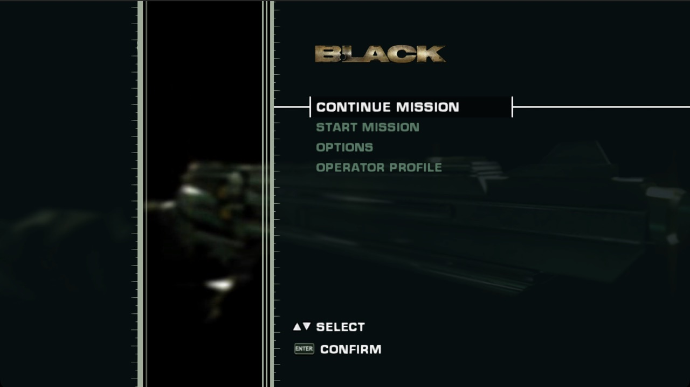 Continue Mission on the title resumes the last checkpoint.</td>
    <td width="50%">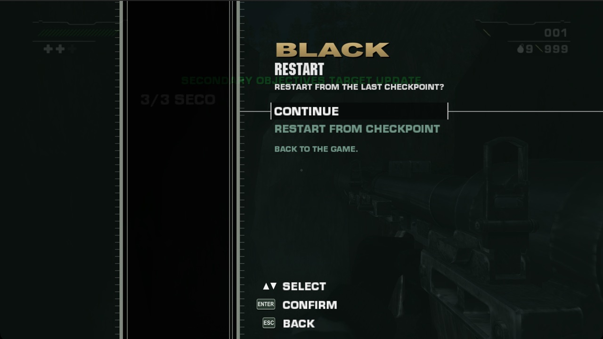 F9 or Back + Y: back to the checkpoint, after a question.</td>
  </tr>
  <tr>
    <td width="50%">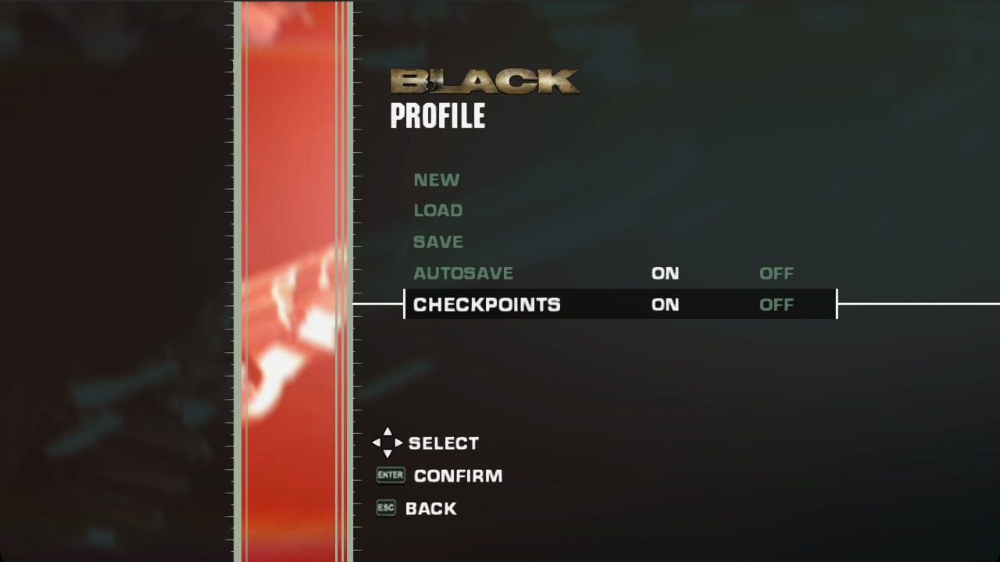 Options → Profile: Checkpoints, under the game's Autosave.</td>
    <td width="50%">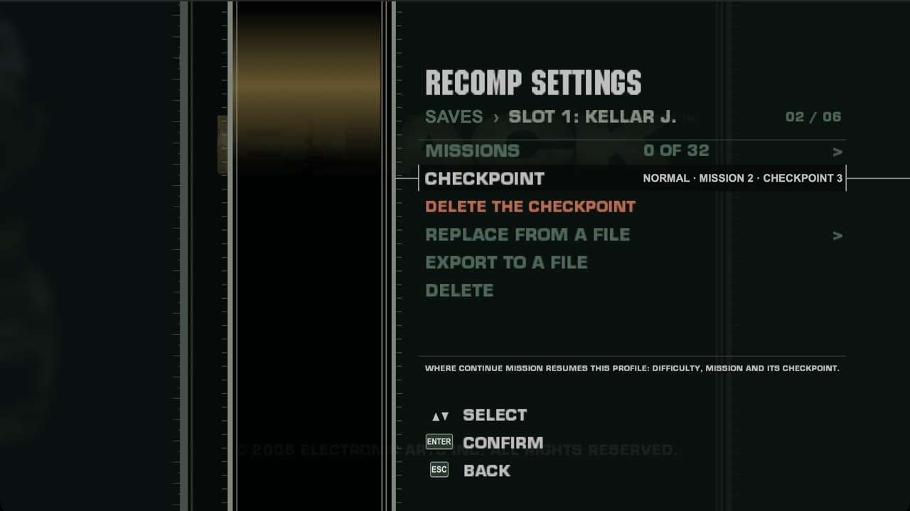 A slot's checkpoint in Saves, with Delete.</td>
  </tr>
</table>

- **Continue Mission** on the title resumes the active slot's checkpoint. While
  checkpoints are on, the game's own button reads **Start Mission**: it opens
  the mission list and starts the chosen mission from its start.
- **F9** or **Back + Y** in a mission ask, then go back to the last checkpoint
  of this run.
- The game's own **Restart** (pause menu, Mission Failed) starts the mission over
  and removes its checkpoint, as on the console. Completing any mission retires
  the profile's checkpoints.
- Checkpoints need the game's **Autosave**. **Options → Profile → Checkpoints**,
  under Autosave, and **Saves → Save Checkpoints** are the same switch, on by
  default. A slot's page shows its checkpoint and can delete it.

## Your data and updates

Data is stored in `~/Library/Application Support/BLACK/`:

| Folder/file | Purpose |
| --- | --- |
| `Game/` | Your privately installed game files |
| `Data/xboxrecomp/` | Xbox saves, profile backups, metadata and virtual cache partitions |
| `Data/Import/`, `Data/Export/` | Profiles to import, and exported slots |
| `Data/xboxrecomp/Checkpoints/` | Checkpoints kept between launches |
| `Data/xboxrecomp/SlotInfo/` | Each slot's last mission, time, picture and mission results |
| `settings.ini` | Recomp preferences and bindings |
| `Logs/run-*/` | A separate log for every launch |

Replacing the app in Applications leaves Library data intact. Back up `Data/`
before changing save files. Development launcher data under `out/macos/user/`
is separate and is not automatically migrated or deleted.

## Building and reporting issues

[Build instructions](docs/BUILD.md) cover pinned sources, revision checks and packaging.
The root tree/history retains the upstream Windows implementation; its D3D12
features do not describe this Mac build. [Upstream README](docs/UPSTREAM_README.md).

Include the version, Mac model, macOS version, settings and reproduction steps
when reporting a problem. Distinguish a normal exit from a time limit.
For a controls problem, **Controls → Gamepad and Vibration → Advanced Gamepad →
Controller Diagnostics → Save Black Box** writes the last minute of input the
game saw, with a copy of your settings, as `black-box-<date>.csv` beside the
settings file; attach it. Do not attach game data, private saves or unredacted
personal information.

## Acknowledgements

Special thanks to **[TGP482 / BLACK-XBERecomp](https://github.com/TGP482/BLACK-XBERecomp)**
for the Original Xbox BLACK recompilation project, Xbox XBE Recomp tooling,
settings/menu design, control policies and the checked European revision patch.

Special thanks to **portingpete** and **[Black-2006-Recomp](https://github.com/portingpete/Black-2006-Recomp)**:
its launcher is the model for this port's first-time setup and its menu look,
its Xbox-to-pack map drives HD texture replacement, and its notes on the string
banks, the game fonts and save profiles, its audio completion work and its film
timing research guided much of the work here. Thanks as well for xboxrecomp.

Thanks to **soldieg** for [BLACK-SUBTITLES](https://github.com/soldieg/BLACK-SUBTITLES),
the source of the Russian film subtitles.

Thanks to **elpetese** for the [native macOS game host](https://github.com/elpetese/black-macos-recomp)
and [runtime](https://github.com/elpetese/black-macos-runtime), **sp00nz** for
xboxrecomp and BLACK runtime work, the **xemu** team for Xbox
hardware/rendering/audio foundations, **Matt Borgerson** for dsp56300, and the
**ANGLE**, **SDL** and other library contributors.

The [Burnout Revenge project](https://github.com/secretpray/burnout-revenge) served
as a product and packaging reference. BLACK keeps its own code, runtime ABI and data.
See [component provenance](THIRD_PARTY_NOTICES.md) and the app's
`Contents/Resources/Licenses/` for upstream licenses. The combined executable
contains differently licensed components and is not described as wholly MIT licensed.
